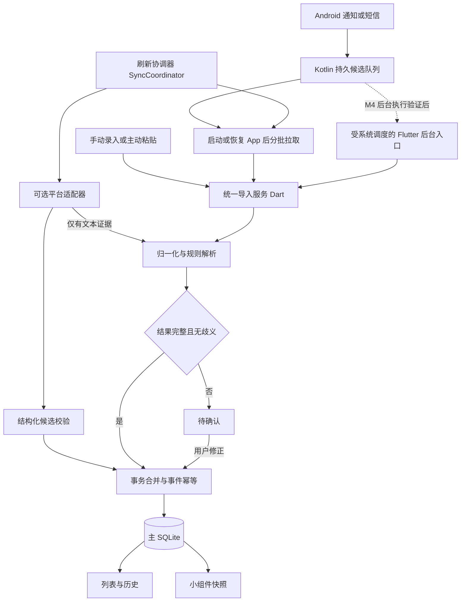

# 取件助手设计与实施计划：参考 Parcel 与 ExpressAssistant

> 更新日期：2026-10-19。状态：双参考项目设计基线，尚未编码实现。
> 需求见 [需求文档](取件助手需求文档.md)，执行起点见 [交接文档](项目现状交接.md)。
> 本文替代旧设计中的“先登录再进入首页”“以 H5 自动抓取为主”“平台侧消失即已取”等约定。

## 1. 设计决策

1. 保留 Flutter、Riverpod、GoRouter、sqflite 和现有功能分层，不迁移为原生 Compose 应用。
2. 直接借鉴 Parcel 的解析策略和使用体验：本地规则、柜号／格口区分、地址标签、失败消息修正、备注分享、大字和桌面卡片。
3. 所有取件码来源经过同一 Dart 解析／合并服务；Android 原生层负责系统接入与可靠暂存，不复制一套 Kotlin 业务解析器。
4. 不登录也能完成录入、查看与取件。通知识别优先交付，短信为独立可选来源；H5 抓取为后置扩展。
5. 借鉴 Parcel 的官方 App 身份码跳转，但保留当前应用内 H5 查看。深链只是候选入口，需逐个平台真机验证。
6. 主数据库是业务事实来源；小组件只展示可重建快照。后台可靠暂存、解析和实时展示分别验收，不承诺系统永久保活。
7. ExpressAssistant 用于登录配置、渠道适配、同步互斥、结果报告及失败保留数据；可立即用于 M0/M1 的设计，不把全部价值延后到 M5。
8. 接入区分“原始文本事件”和“平台结构化候选”：文本走统一解析器，结构化候选做字段校验，两者汇入同一个事务合并服务。平台数据不再先拼成短信再重新解析。
9. 统一刷新协调器在 M1 先用 fake 适配器验收，M2 接原生队列，M5 才启用真实网络适配器；本地列表优先展示，网络结果分批补充。
10. 默认保留 Cookie 在 WebView 内的会话边界。ExpressAssistant 的导出 Cookie、签名 HTTP 请求和 SSR 解析属于可选研究路线，与 DOM 抓取分别验证，不默认复制为生产实现。

## 2. 双参考项目与复用边界

| 参考项目 | 主责 | 在本项目中的采用阶段 |
| --- | --- | --- |
| Parcel | 文本规则、柜号／格口、地址分组、自定义修正和轻量取件体验 | M1—M4 |
| ExpressAssistant | WebView 登录配置、平台适配、同步编排、保留用户字段和渠道报告 | M0/M1 复用设计；M5 验证平台数据获取 |

保留上方旧锚点以兼容 README 的已有链接。本轮仅修改 docs 中三份文档；README 的本地优先路线与 M0—M5 概览继续有效，双参考设计细节以本文为准。

### 2.1 参考快照

研究日期为 2026-10-19，读取了 Parcel main 源码压缩包，ZIP 注释标识提交 `d7e4c974ffd1e4de2da9291df0d295856cd89818`。下列链接固定到该提交，便于后续复核；本次未编译或安装 Parcel，源码存在不等于目标机型已验收。

源码前缀：`app/src/main/java/com/xxxx/parcel/`。

| 来源 | 已核实的做法 | 本项目采用方式 |
| --- | --- | --- |
| [SmsParser.kt](https://github.com/shareven/parcel/blob/d7e4c974ffd1e4de2da9291df0d295856cd89818/app/src/main/java/com/xxxx/parcel/util/SmsParser.kt) | 支持自定义地址／码规则、忽略词，分开解析柜号与格口，中文柜号转换，排除时长／费用误判 | 移植规则思路和柜号转换到纯 Dart；扩展为多候选返回，补齐中文与 Unicode 语料 |
| [SmsProcessor.kt](https://github.com/shareven/parcel/blob/d7e4c974ffd1e4de2da9291df0d295856cd89818/app/src/main/java/com/xxxx/parcel/util/SmsProcessor.kt) | 系统短信与自定义消息共用处理，地址映射后分组，同日地址＋码去重，已完成状态单独计算 | 共用导入管线、分组和持久完成状态；去重增加事件身份和包裹生命周期 |
| [ParcelNotificationListenerService.kt](https://github.com/shareven/parcel/blob/d7e4c974ffd1e4de2da9291df0d295856cd89818/app/src/main/java/com/xxxx/parcel/service/ParcelNotificationListenerService.kt) | 按来源 App／标题筛选，提取通知正文，短时间重复抑制，通知内容转入统一消息处理 | Kotlin 监听与正文提取可适配复用；改为持久事件队列，不依赖内存去重或固定休眠 |
| [ThirdPartyEntry.kt](https://github.com/shareven/parcel/blob/d7e4c974ffd1e4de2da9291df0d295856cd89818/app/src/main/java/com/xxxx/parcel/util/ThirdPartyEntry.kt) | 淘宝和拼多多使用 Intent／深链打开官方 App，并尝试备选入口 | 作为外部身份码入口参考，不宣称 Parcel 在应用内生成或抓取身份码；失败显式返回结果 |
| [save_data.kt](https://github.com/shareven/parcel/blob/d7e4c974ffd1e4de2da9291df0d295856cd89818/app/src/main/java/com/xxxx/parcel/util/save_data.kt) | 本地保存规则、地址标签和备注等设置 | 采用同等功能，业务记录仍用 SQLite，不复制整份 SharedPreferences 存储组织 |
| [ParcelWidget.kt](https://github.com/shareven/parcel/blob/d7e4c974ffd1e4de2da9291df0d295856cd89818/app/src/main/java/com/xxxx/parcel/widget/ParcelWidget.kt) | Android AppWidgetProvider／RemoteViews 展示待取记录 | 先实现单一标准小组件；使用本项目快照协议，不读取另一份业务数据库 |
| [SmsParserLockerNumberTest.kt](https://github.com/shareven/parcel/blob/d7e4c974ffd1e4de2da9291df0d295856cd89818/app/src/test/java/com/xxxx/parcel/SmsParserLockerNumberTest.kt) | 柜号识别有独立测试入口 | 作为测试组织参考，新增本项目脱敏回归语料 |
| [LICENSE](https://github.com/shareven/parcel/blob/d7e4c974ffd1e4de2da9291df0d295856cd89818/LICENSE) | 标注 MIT，版权为 2025 shareven | 实际移植代码／规则时保留版权及许可文本，记录原路径、提交和修改范围 |

交互参考另见 [Parcel README](https://github.com/shareven/parcel/blob/d7e4c974ffd1e4de2da9291df0d295856cd89818/README.md)。本次仅形成文档；真正复制或移植代码时，再将来源说明随实现一并提交。

### 2.2 不直接照搬的部分

- Java Pattern 与 Dart RegExp 的字符类、分组和 Unicode 行为需逐条验证，不整体复制正则字符串后视为完成。
- 不把多个码拼成一个逗号字符串存入 PickupCode；一个有效码对应一条业务记录，保留同一事件下的关联。
- 不复制短信／通知原文日志、静默吞错、固定 sleep 去重或“监听就能永久保活”的假设。
- 不复制厂商专属卡片、WRITE_SECURE_SETTINGS、全盘存储权限或全局电池优化豁免。
- Parcel 的离线清单思路适用于本项目本地模块；本项目 H5 仍需 INTERNET 权限。

### 2.3 ExpressAssistant 固定源码依据

读取提交 `5adcfa780017ab0fb9888e5aaeef7b6a8d311209` 的源码压缩包，并核对 ZIP 提交标识。源码前缀为 `app/src/main/java/com/halo/expressassistant/`；未安装、构建或使用真实账号执行请求，以下均为静态核实，不代表平台接口当前在用户账号可用。

| 固定源码 | 已核实的做法 | 采用／调整 |
| --- | --- | --- |
| [TbLoginActivity.kt](https://github.com/Halo0sama/ExpressAssistant/blob/5adcfa780017ab0fb9888e5aaeef7b6a8d311209/app/src/main/java/com/halo/expressassistant/ui/TbLoginActivity.kt) | 开启 DOM storage 与第三方 Cookie，检测淘宝会话 Cookie；同时清全部 WebView Cookie 并导出会话 | 借鉴初始化顺序与登录状态验证；不照搬全局清理、Cookie 外导、固定伪装 UA 或正式包 WebView 调试 |
| [SyncEngine.kt](https://github.com/Halo0sama/ExpressAssistant/blob/5adcfa780017ab0fb9888e5aaeef7b6a8d311209/app/src/main/java/com/halo/expressassistant/ui/SyncEngine.kt) | Mutex 串行同步轮次、部分渠道并行、ChannelStatus/Report、空结果保留旧数据、合并保留用户字段、过滤已删除条目 | M1 实现 Dart 协调器；改用明确状态、作用域、超时和取消，避免仅按运单号合并和把错误当空列表 |
| [TbOrders.kt](https://github.com/Halo0sama/ExpressAssistant/blob/5adcfa780017ab0fb9888e5aaeef7b6a8d311209/app/src/main/java/com/halo/expressassistant/api/TbOrders.kt) | 导出会话参与签名订单请求，解析物流详情 SSR 内嵌数据 | M5-C 单独研究，不能当作已验证的 DOM 选择器，也不能把非公开请求视为稳定开放 API |
| [CaiNiaoGoodsResolver.kt](https://github.com/Halo0sama/ExpressAssistant/blob/5adcfa780017ab0fb9888e5aaeef7b6a8d311209/app/src/main/java/com/halo/expressassistant/ui/CaiNiaoGoodsResolver.kt) | 利用淘宝会话查询物流轨迹及商品信息 | 仅研究能否获得取件字段，不引入商品、完整物流时间线或订单同步产品范围 |
| [GoodsPresentation.kt](https://github.com/Halo0sama/ExpressAssistant/blob/5adcfa780017ab0fb9888e5aaeef7b6a8d311209/app/src/main/java/com/halo/expressassistant/ui/GoodsPresentation.kt) | 按取件语义提取单个码，支持多段轨迹文本逐段检查 | 扩展 Parcel 语料到物流摘要；仍由本项目多候选解析器处理，不照搬只取首码逻辑；无取件信息不生成取件记录 |
| [Store.kt](https://github.com/Halo0sama/ExpressAssistant/blob/5adcfa780017ab0fb9888e5aaeef7b6a8d311209/app/src/main/java/com/halo/expressassistant/data/Store.kt) | 每渠道账号元数据与启停设置、用户字段和缓存；Cookie payload 也存在普通偏好中 | 采用来源作用域及元数据模型；不采用普通 SharedPreferences 存凭证或“账号找不到就回退其他账号” |
| [LICENSE](https://github.com/Halo0sama/ExpressAssistant/blob/5adcfa780017ab0fb9888e5aaeef7b6a8d311209/LICENSE) | MIT，版权为 2026 Halo0sama | 实际移植时保留许可和版权、原路径及修改说明，与 Parcel 分别记录 |

### 2.4 双参考后的明确取舍

- 采用 ExpressAssistant 的协调机制，不按其“渠道固定优先级”覆盖本地人工修改；业务表仍用 SQLite，不迁移成偏好文件整表覆盖。
- 同步实现里存在 `catch Throwable` 和失败返回空列表，本项目明确传播取消、区分网络失败与合法空结果，并逐作用域隔离；不照搬其所有账号错误隔离粒度。
- 源码的空结果保留策略用于防误清；本项目同时显示最后成功时间与过期状态，不让旧数据长期伪装成新数据。平台侧签收／交易完成与用户实际已取保持分离。
- 不照搬打开登录页即清除全部 Cookie 的行为。普通查看不退出其他平台；明确的“退出全部账号”才能执行全局清除，单平台隔离能力不足时说明影响范围。
- 不引入 ExpressAssistant 的 AI 日报、商品短名、物流追踪、MCP 服务、Shizuku、小米账号接入或无障碍抓取；多账号真实绑定不进入首版，仅预留作用域字段。
- M5-C 的输出是 DOM／SSR／签名接口的实测比较与采用决策。默认仅交付通过验证的 WebView 内读取路径；Cookie 外导所需安全存储、退出失效和网络客户端管理未设计并验证前，该研究分支不进入正式包。

## 3. 架构与后台边界

### 3.1 模块划分

| 模块 | 位置建议（计划） | 职责 |
| --- | --- | --- |
| TextPickupParser、规则、候选模型 | `lib/features/pickup/domain/` | 纯 Dart，无权限／Widget／数据库依赖 |
| PickupImportService、事件和规则仓库 | `lib/features/pickup/data/` | 解析编排、事务合并、重试、保留用户字段 |
| SyncCoordinator、SourceAdapter、SyncReport | `lib/features/pickup/domain/` 契约与 `data/` 实现 | 统一刷新、按来源报告、超时／取消、批次提交，不绑定 Widget |
| PlatformSessionRepository、PlatformPickupAdapter | `lib/features/auth/` 与 pickup 数据层 | 会话元数据、登录探测、平台字段适配；不把网络取件能力混进身份码页面 |
| AndroidCaptureBridge | `lib/core/platform/` | MethodChannel 拉取／确认、状态查询；EventChannel 仅作在线提示 |
| CaptureInbox、NotificationCaptureService、SmsReceiver | Android 当前应用包目录下按职责拆分 | 授权校验、候选过滤、SQLite 暂存、系统服务接入 |
| 导入、待确认、历史、规则与分组页面 | 现有 feature presentation 目录 | 复用 Riverpod 仓库注入与路由工厂 |
| WidgetSnapshotWriter、AppWidgetProvider | Dart 数据层＋Android widget 目录 | 写快照、标准 RemoteViews 展示、进入详情 |

后台实现不创建第二套解析规则。原生队列使用独立 `capture_inbox.db`，仅 Kotlin 创建和迁移；主库 `express_pick.db` 仅由 Dart 仓库创建和迁移。原生层不直接写业务表。

### 3.2 接收、处理与确认协议

M2 只保证系统回调实际送达后先持久保存、下次启动／恢复 App 时解析。App 未运行时，不承诺已完成业务入库或刷新小组件；界面明确显示待处理数量和最后处理时间。

1. 原生层检查来源开关及包名白名单，将合格通知／短信候选写队列后立即返回；不在系统回调内等待 Flutter 启动。
2. MethodChannel 提供 `listPending(limit: 100)`、`ack(eventIds)`、`getCaptureStatus()` 和来源配置更新。每次恢复先查询权限真实状态，再分批拉取。
3. Dart 在主库事务中完成事件标记、候选或业务记录写入；提交成功后才 ack 原生队列。
4. 主库成功但 ack 前崩溃时，重投由事件唯一键消重；主库失败不 ack，允许重试。毒消息标记错误并隔离，不阻塞后续事件。
5. EventChannel 不是存储通道。断连后通过队列补偿；撤销权限或关闭来源后停止采集，未处理内容可由用户清空。
6. 队列上限 500 条、单条正文 4 KB、原文保留 7 天；溢出时删除最旧未处理候选并累计可见丢弃计数，不静默宣称零丢失。短信由用户重扫，通知通过粘贴补录。

M4 再验证唯一 WorkManager 工作触发 Flutter 后台入口，显式注册插件，调用同一导入服务。前后台工作由队列消费锁协调，主库事务提供最终幂等；锁必须有超时恢复。任务进程死亡、插件初始化失败均保留未 ack 候选。系统延期、用户强行停止后无回调等限制必须如实显示。

M4 验证失败仍交付 M2 暂存模式，小组件标记快照时间，不能把旧内容显示为“已实时更新”。不通过长期前台服务维持解析。

### 3.3 统一来源契约与刷新协调

SourceAdapter 按 `SourceScope(sourceType, platform?, sessionRef?)` 声明能力，输出异步批次 `PickupEvidence`，最终返回 `SourceSyncResult`。证据可为 TextEvidence 或 StructuredPickupCandidate：前者带必要原文供解析，后者带码、点、稳定来源ID、来源时间、字段证据及字段完整性，必须校验后才能合并，不接受未经适配的任意平台 JSON。

同一轮包括本地候选队列与用户启用的网络来源；首版只接文本与队列，平台适配器用 fake 验证契约。字段为空或无码的物流包裹不进入正式取件表；有取件码但缺点位进入待确认。H5 数据源和将来可能采用的平台 HTTP 适配器均复用此契约，不能另建平行清单。

| SourceSyncResult 状态 | 语义与数据处理 |
| --- | --- |
| disabled / notConfigured | 来源关闭／无适配配置；跳过，不算失败，不修改旧件 |
| needsLogin | 尚未登录或会话过期，保留旧件，提示重新登录 |
| success | 拉取完整并校验通过；可以是合法零条，更新最后成功时间，不据此删除记录 |
| partial | 已有批次提交，后续页失败／超时；保留已提交批次与旧件，报告缺失部分 |
| failed | 未取得可提交批次，报告网络／页面／解析错误，保留旧件 |
| cancelled | 用户或系统取消；停止后续拉取，已提交批次保留，不显示为同步成功 |

报告包含 runId、scope、开始／结束时间、lastAttemptAt、lastSuccessAt、各状态错误码和新增／补充／重复／待确认计数；UI 显示“新增2、重复3、1个来源需登录”，不能用抓到总条数代表新增，也不能静默一律提示“已刷新”。部分成功单列 lastPartialAt，不能更新 lastSuccessAt 冒充完整成功。

- 用户下拉、首页自动刷新及恢复导入共用 single-flight：已有同类运行时附着其结果，不重复排队发请求；不持有数据库事务等待网络。
- 网络源最多两个独立会话并行；共享同一 WebView Cookie 容器的操作串行。每来源总超时初始10秒，含翻页、加载、JS执行及清理；前台整轮初始30秒，离开页面可取消。
- 分批校验、按批事务合并，最多100个候选／批；提交后局部刷新列表，不等最后一个来源结束才展示结果。无来源时间时用 capturedAt 并明确时间依据，不伪造原事件时间。
- 同一 scope 只允许一个活跃 writer；新运行替代旧运行时先取消旧任务，再按 runId／generation 拒收迟到批次。字段有来源版本／时间时不接受更旧值覆盖新值；不因重抓将 firstSeenAt 改为现在。
- 后台导入与前台导入共用事件幂等及队列消费锁；M4 后台只消费已入队内容，不默认定时唤起平台 WebView 或请求账号接口。
- 单页临时网络失败最多一次退避重试，仍受总超时限制；needsLogin、风控提示、解析结构变化不自动循环重试，转显式状态。取消要向上传播，清理不吞取消或使总超时失效。

### 3.4 会话与账号作用域

M0 先修复现有单会话 H5；M1 预留本地 sessionRef，M5 每个平台只验证一个启用账号。淘宝／菜鸟共享会话时共用 sessionGroup 和锁，不能声称不同 WebView 实例天然隔离账号。

sessionRef 仅为本地关联标识，不是 Cookie/token；元数据包含平台、label、状态、最后探测时间和可用能力，不能仅因 Cookie 存在就确认账号有效。账号标识无法核实时保持临时会话作用域，既不合并其他账号，也不回退到首个启用账号。

退出／解绑／权限撤销时先取消相关运行并递增 generation，迟到结果禁止入库；保留本地记录，清除相应会话状态和未消费网络候选。用户切换账号后新建作用域，旧记录仅作为历史数据展示。真正多账号隔离及 Cookie 外导不属于已实现能力，须在 M5 比较后独立设计。

## 4. 数据模型、迁移与去重

### 4.1 数据结构（计划）

| 表／模型 | 关键字段 | 约束 |
| --- | --- | --- |
| pickup_codes / PickupCode | 原 id、code、pickup_point、platform、is_picked、picked_at；新增 normalized_code、locker_number、compartment_number、note、first_seen_at、last_seen_at、field_overrides | id 稳定；platform 可空，表示未知；备注和人工修改具有最高优先级 |
| source_events | event_key、source_type、source_app、source_scope、source_identity、occurred_at、captured_at、payload_hash、status、error_code、parser_version | event_key 唯一；原文成功处理后不保留；事件时间、接收时间与采集时间依据分开 |
| pickup_sources | pickup_id、event_key、candidate_index | 同一事件可关联多个码；同一码可关联多个来源 |
| source_sync_states | scope、last_attempt_at、last_success_at、last_partial_at、last_result、error_code、generation | 按来源／会话分别记录；禁止用另一账号的成功覆盖本账号失败 |
| platform_source_items（M5） | scope、provider_item_id、provider_revision、provider_status、pickup_id | 只存取件所需的来源关联；物流状态不映射为本地已取，不建设全量订单库 |
| pending_candidates | event_key、候选字段、reason、必要原文、expires_at | 缺地址和冲突不伪造平台／地址；7 天后清除原文，用户仍可手动补全结构化字段 |
| parse_rules | id、type、pattern、priority、enabled、version | 仅本地规则；内置只读，用户规则可停用与试运行 |
| address_aliases | original_address、normalized_address、group_id | 别名用于地址规范化；修改别名需预览潜在合并冲突 |
| address_groups | id、name、sort_order | 展示标签不参与身份判定；“学校”下不同柜点仍是不同取件点 |
| import_tombstones | 去重标识、deleted_at、expires_at | 删除后 30 天抑制相同来源旧事件重放；新事件仍按生命周期判断 |

source_type 为 manual / pastedText / notification / sms / h5，与 PickupPlatform 独立；未来研究采用其他平台 transport 时再扩展枚举，不把来源标签当成接口实现。platform_source_items 及会话存储由 M5 按实际采用路径单独迁移，M1 不预建 Cookie 或全量订单表。平台未知不能用 taobao 补齐。保留物流平台枚举兼容旧数据，但不新增快递100接入。

### 4.2 v1 升级

现有数据库为 version 1，platform 非空，存在 `UNIQUE(platform, code, pickup_point)`。目标迁移需要重建业务表以允许未知平台并移除永久去重约束；不依赖 Android 各版本 SQLite 对新语法的支持。

- 在升级事务中建新表，保留旧 ID、状态、取件时间和全部可选字段，复制后校验行数，再切换表及索引；失败回滚，禁止删除用户数据库重建。
- 老记录 firstSeenAt／lastSeenAt 用 createTime 回填；已取状态原样保留；来源记为 legacy 元数据，不虚构短信或 H5 来源。
- 新 schema 按任务分版本演进（v2 基础、v3 规则／分组等），每一版同时覆盖新装与相邻旧版升级。
- SQLite 仓库与内存测试实现必须保持相同合并语义；Migration 测试用真实 SQLite，不用内存仓库替代。

### 4.3 两层去重与生命周期

第一层解决同一事件重投：短信使用设备本地短信 ID＋原始时间；广播尚无 ID 时用发送者＋原始时间＋正文摘要，与收件箱记录建立别名。通知使用包名＋通知 key＋正文摘要；key 重用但正文改变视为新事件，重复回调不新建。手动保存生成操作 ID；平台有稳定条目 ID 时使用 scope＋条目ID＋字段版本或内容摘要，区分原条目重抓和条目变化；无稳定ID时用scope＋规范化候选摘要，批次ID仅追踪执行，不作为业务唯一键。摘要只用于本地比对，不输出到日志。

第二层判断是否为同一包裹：

1. 有相同稳定来源条目身份且无冲突时，关联原记录；更新来源时间，不重置用户状态。
2. 无稳定身份时，在原事件发生时间相差 24 小时内，以规范化码＋真实取件点＋柜号／格口匹配；仅唯一且平台／账号不冲突时合并。未知平台不妨碍唯一强匹配；仅“4号柜”等弱地址或多个候选时转待确认。
3. 已取记录 24 小时内收到相同码和地址，不自动恢复待取；展示为重复来源。
4. 新事件发生在已取后且超过 24 小时，允许同点同码作为新包裹新增。仅到达时间变晚、原事件时间未变的历史重扫不能触发新增。
5. 超过 24 小时仍存在同点同码待取，或已知平台／账号互相冲突，进入待确认，由用户选择关联旧件或新增。不靠永久 UNIQUE 约束误吞新包裹。

24 小时是本项目初始产品规则，可由语料和真实使用再调整，不是 Parcel 已验证结论。分组标签、备注和展示排序均不参与去重键。

平台一个订单可能有多个包裹，不把 orderId 单独当取件条目身份；优先使用平台包裹／条目ID。无可靠包裹身份时回到码＋点位规则。不同已知账号的数据不能仅凭相同运单号或取件码自动合并，账号作用域未知时保留歧义。相同条目后来出现不同码／地址而与人工字段冲突时，转待确认，不直接覆盖或新增重复件。

### 4.4 合并与状态流转

禁止用 `ConflictAlgorithm.replace` 更新业务记录。事务先检查事件，再查询候选，按稳定 id 更新允许字段；空值不覆盖已有值，人工 override 字段不被解析值覆盖，firstSeenAt 不变、lastSeenAt 取最大值。事件与关联关系一并提交。

非人工字段按同一scope的来源版本／时间判断新旧，结构化字段也须有有效来源证据，不能仅因是平台返回就覆盖完整的文本结果。不同来源高可信字段互相冲突时进入待确认；无法比较来源时间时只补缺项，不采用“后到达者获胜”或固定平台优先级。

已取仅由用户确认进入，pickedAt 使用本地操作时间；恢复待取时显式置 null（当前 copyWith 的 `??` 语义需支持“传 null 清空”）。H5 返回空、通知撤回、权限撤销都不得标记已取。列表、详情、历史及快照在事务完成后统一刷新／失效，避免各页面保留不同状态。

借鉴 ExpressAssistant 保留用户字段与删除名单的做法，但 providerStatus（例如签收、交易完成）只记来源状态，与 isPicked 分离；签收可能表示包裹到驿站，并不证明用户已取。网络适配器只做增量补充，不因全量列表缺少某件而删除或完成本地记录。合法空结果显示“本次无新增”，失败／过期显示保留旧数据和最后成功时间；删除墓碑必须在每批合并前检查。

## 5. 解析与规则

### 5.1 输入输出

输入 RawPickupEvent 包含来源、事件标识、原始发生时间、接收时间和正文。输出 ParseOutcome 为 `List<PickupCandidate>`＋忽略／失败原因＋规则版本；Candidate 含码、地址、柜号、格口、平台可选值、命中规则及证据片段位置。

平台仅提供轨迹／通知文案时借鉴 ExpressAssistant 的多段语义检查：先按稳定包裹身份组织文本，再交本解析器。没有取件语义则返回无候选；不能从运单号推断取件码，也不能将多个包裹文本拼接后跨包裹配对地址。平台已经提供结构化字段时跳过正则提取，仅做同等完整性、来源及冲突校验。

固定处理顺序：输入长度／权限／来源过滤 → Unicode 空白与横杠归一化 → 忽略规则 → 用户规则（优先级、同级按 id）→ 内置取件语义规则 → 多码及其邻近地址关联 → 字段校验 → 完整入库或待确认。

只归一化匹配用文本，同时保留展示原码，避免误改大小写等有效码值。多码有明确共同地址可拆成多条；多地址配对不明确时不自动做笛卡尔积。

### 5.2 借鉴后的首批规则

- 关键词优先：取件码、取货码、提货码、签收码及常见繁体写法，避免无上下文抓取所有数字。
- 柜号独立：四号柜、十五号柜、一百零五号柜等转换；格口既支持“23-32格口”，也支持“格口：23-32”。
- 排除时长／费用：如“7号柜36小时免费”中的 36，不当作格口或取件码。
- 支持字母数字、二／三／四段横杠码与同条多码；电话号码、运单号、验证码等按上下文排除。
- 地址优先采用用户明确配置的别名／常用点，保留原取件点证据；无地址进入待确认，不填“未知驿站”后自动合并。

高级正则使用受限语法、输入长度上限及独立 isolate 超时（初始 100 ms）；超时终止该次工作并记录规则错误，不阻塞后续导入。保存前检查捕获组；非法规则不可启用。规则试解析不写业务表，规则更新后由用户选择是否重试待确认；不得默认重建全部历史。

### 5.3 必须覆盖的语料

| 文本（合成示例） | 期望 |
| --- | --- |
| 包裹已到东门菜鸟驿站，取件码 3-1-2088 | 一个码及完整取件点 |
| 包裹已放四号柜，取件码 123456，格口23-32 | 柜号4、格口23-32、码123456；仅有弱地址时待确认 |
| 包裹已到西门驿站，取件码 A-12、B-34 | 两条候选，共同取件点 |
| 7号柜36小时免费 | 不识别出取件码36或格口36 |
| 您的登录验证码为123456，请勿泄露 | 无取件候选 |
| 客服电话13800000000，运单号YT123456789 | 无取件候选 |
| 取件码3—1—2088 | 保留码，归一化后缺地址进入待确认 |
| 东门取件码1-23，西门取件码4-56 | 有清晰邻近关联才分配地址，否则待确认 |

计划测试不少于60条正例、40条反例，按通知／短信／粘贴、厂商格式、繁体、重复与歧义分类；测试使用合成或用户脱敏数据。

## 6. Android 与页面设计

### 6.1 来源与权限

通知由 NotificationListenerService 接入，用户到系统授予通知使用权。普通 POST_NOTIFICATIONS 只控制本 App 的提示，不能替代监听授权。默认关闭自动采集，用户选择包名白名单和可选标题规则；正文兼容普通 text、bigText、textLines、MessagingStyle 消息，过滤自身通知与 group summary，避免重复拼接。

短信 RECEIVE_SMS 与历史 READ_SMS 按功能分别请求，不为粘贴或通知监听强制索取。分段短信按系统协议还原；历史读取近7天默认、近30天可选，分页且可取消。网络／5G消息不保证出现在系统短信库中，提示通知监听或粘贴补录。Android 版本权限与后台行为实现时核对官方文档，不复制 Parcel 的前台服务启动方式作为通用保证。

显示来源已开启／未授权／服务未连接／待处理数量／最后成功时间。服务断线后请求系统重新绑定，App 恢复时检查实际授权；被强行停止后需用户重新打开，不能把这种状态显示为“实时监听中”。

### 6.2 页面交互

首页顶部待取总数和身份码入口，下方按地址标签分组，组内按真实取件点、柜号排序；保留切回时间排序。单码可复制和标记，标记后提供撤销；详情支持备注、来源摘要、历史操作及确认删除。待确认不计入正式待取数量，首页另显示数量入口。

导入文本后显示拆分候选，缺项就地编辑；多个码选择后批量确认。规则页提供示例输入、命中规则和结果预览；地址标签页修改时展示受影响记录，不自动批量合并历史。

大字模式尊重系统字体缩放，保持完整码可见，不依赖颜色区分状态。第一版分享仅使用系统文本分享，后续再考虑图片卡片。

### 6.3 身份码、会话及平台数据获取

保留资产配置中的真实 URL，不将 Parcel 深链直接写成已验证地址。外部入口采用“候选深链 → 官方 App 首页 → 明确失败提示”，包可见性仅声明所需目标；H5 与外部 scheme 分开校验。

M0 参考 ExpressAssistant 的 DOM storage／Cookie 初始化顺序，修复主 Manifest 联网权限、主文档／子资源错误区分、mounted 检查和重试状态；登录态至少区分 unknown、notLoggedIn、loggedIn、expired，不能用没有登录提示文本推断一定已登录。跨域 iframe 的第三方 Cookie 配置需要 Android 专用适配并真机验证；正常打开页面不清所有平台会话，退出不复制或输出 Cookie。Cookie 特征仅用于辅助探测，不直接等同于服务器确认成功。

M5 才启用真实平台取件数据获取，采用以下路径比较；首个平台优先淘宝／菜鸟共享会话，只验证一个账号，不一次承诺所有平台可用。

| 路径 | 会话与获取方式 | 当前决策与验收条件 |
| --- | --- | --- |
| A：WebView 内 DOM／页面自带数据 | 会话留在官方 H5 的 WebView；提取可见取件信息或已加载的结构化数据 | 默认生产候选；需确认页面渲染、字段归属和取件信息真实存在，不解析身份码 |
| B：会话签名 HTTP＋SSR | 参考 TbOrders/CaiNiaoGoodsResolver，独立客户端使用导出会话发请求，再适配结构化结果 | 仅研究，默认关闭；改变现有会话边界，不能直接抄接口启用 |
| C：官方 App 跳转／文本导入 | 用户查看官方入口，主动复制内容走本地解析 | A/B失效时长期可用的回退，不伪称自动抓取成功 |

A路径须完成 Android 包装字符串与 iOS 直接字符串归一化、总超时、数据就绪等待、可信 HTTPS 导航、JSON编码注入选择器、资源清理及取消；复用 SyncCoordinator 的报告和隔离。离屏 WebView 不能渲染时使用用户可见页面入口，仍不满足则保留C，不能仅补选择器就宣布可用。

M5-C 形成路径比较记录：固定参考提交、使用的页面／字段、登录前后和重启后的行为、至少3轮刷新重复情况、有无真实取件码／完整点位、空数据与错误能否区分、分页完整性、账号作用域和退出后的请求失效。没有取件字段的物流结果不算通过；样例只用脱敏fixture，Cookie和真实订单原文不提交仓库。研究结果可判定“不可采用”，不阻塞其他里程碑。

B路径若决定采用，应先另行补齐并验证：Keystore／Keychain支持的安全会话存储、独立客户端Cookie生命周期、域名白名单、解绑立即取消与撤销、备份排除、token过期更新、无凭证日志、风控停止请求及数据清理。设计决策、相关需求及测试先形成独立任务，再实现；当前不添加接口密钥、不更改资产配置、不默认开启外部会话请求。保留既有“不绕过登录验证、不高频轮询”的边界。

### 6.4 小组件

Dart 主库事务后生成带 schemaVersion、revision、updatedAt 的最小快照，经原子替换交给原生展示；只含待取码、地址、显示 ID，不含消息原文、Cookie、身份码或待确认候选。标记／删除后更新快照；更新失败重试并保留时间提示。

首版一种标准尺寸，适配暗色与字体；点击打开详情，先不实现 Widget 直接修改业务状态，减少多写入端。M4 验证后台解析成功后才允许自动发布新快照；无前台 engine 时由 AppWidgetProvider 读取旧快照并显示更新时间。

## 7. 本轮 review 问题与前置修复

| 问题 | 证据与影响 | 处理阶段 |
| --- | --- | --- |
| release 缺少联网权限 | INTERNET 只在 debug/profile 清单声明 | M0-A |
| 跨域登录缺少第三方 Cookie 配置 | 菜鸟页内嵌淘宝 iframe；静态配置不足，实际登录仍待真机 | M0-B |
| Android JSON 返回值被多包装一层 | 插件保留字符串编码，当前只解码一次；做过等价 JSON 最小复现，未运行 Flutter 测试 | M5-A，启用抓取前必须完成 |
| REPLACE 导致换 ID 与已取状态丢失 | 用当前建表语句在 SQLite 复现重复插入换 ID、状态和可选字段清空 | M0-C |
| 子资源错误触发整页错误 | 当前未检查 isForMainFrame，错误也不随成功加载清理 | M0-B |

这些问题尚未修复。H5 JSON 问题因当前没有 pickupUrl 暂不触发；不得阻塞 M1—M4，但在 M5 启用前属于必修项。

## 8. 实施计划

### 8.1 里程碑与依赖

| 阶段 | 目标与交付出口 | 依赖 | 规模估计 |
| --- | --- | --- | --- |
| M0 基础可靠性 | 借鉴 ExpressAssistant 登录配置，修复正式包、WebView和仓库，恢复SDK后提供验收包 | 无 | 4—6 个小任务 |
| M1 本地识别与刷新底座 | Parcel解析、迁移、幂等与历史；ExpressAssistant启发的协调器、分来源报告及分批提交，以fake来源验证 | M0-C、M0-D | 10—15 个小任务 |
| M2 通知入口 | 原生候选持久暂存、前台拉取确认、权限及来源状态 | M1 | 5—8 个小任务 |
| M3 Parcel 常用体验 | 可选短信、自定义规则、地址标签、备注分享、身份码外部入口 | M1；通知联调依赖M2 | 8—12 个小任务 |
| M4 桌面与后台 | 标准小组件、大字适配、受系统调度的后台解析验证 | M2；短信联调依赖M3 | 5—8 个小任务 |
| M5 平台扩展与路径验证 | 默认WebView内读取；比较ExpressAssistant接口／SSR路线，仅启用已通过平台适配器 | M0、M1-G/H及真机账号验证 | 6—9 个小任务；研究结论与功能上线分别验收 |

规模包含实现、测试与验收，不是完成日期承诺。每个代码小任务最多改3个文件，含对应测试；下表为任务包，超过3个文件时必须再拆成“契约／实现／接线／验收”等提交。包完成前不将整阶段标记完成。SDK 不可用时先恢复工具链，不盲目估算构建时间。

### 8.2 可执行任务包

| 编号 | 工作内容／涉及区域 | 必需验证与出口 |
| --- | --- | --- |
| M0-A | main Manifest 联网权限；release 构建链路 | 合并清单检查、release 真机能打开 HTTPS |
| M0-B | 参考TbLoginActivity完善WebView配置、登录状态和Android Cookie适配，不外导Cookie | 主／子资源错误、退页回调mock；普通查看不清其他会话，真机登录／退出／重启 |
| M0-C | SQLite upsert 改合并，修正内存仓库语义 | 重复写入 ID 不变、已取不复活、可选字段保留的真实 SQLite 测试 |
| M0-D | copyWith 可清空字段、详情／列表状态统一失效 | 取件→恢复 pickedAt 为空，重进详情与列表一致 |
| M1-A | source_type 与候选模型，明确未知平台 | 序列化兼容旧值、字段空值和多码测试 |
| M1-B | 版本迁移、事件及关联表，移除永久去重约束 | v1→目标版及新装测试，行数／ID／历史保持，失败回滚 |
| M1-C | 内置 Dart 解析器及语料 | 60正例／40反例全部通过，中文柜号／格口／多码归属可解释 |
| M1-D | PickupImportService 事件幂等与生命周期合并 | 重放、跨来源重复、24小时边界、已取后新包裹、删除墓碑测试 |
| M1-E | 粘贴预览与待确认页，接入现有手动录入 | 缺地址不可自动成为正式记录，修正后一次入库 |
| M1-F | 历史查询、恢复和清空入口 | 历史筛选、撤销、确认删除与旧数据展示 widget 测试 |
| M1-G | SourceAdapter／PickupEvidence／SyncReport契约与Dart协调器，先接fake来源 | 互斥附着、各scope状态、空／失败区分、部分成功、总超时、取消、迟到批次拒收 |
| M1-H | 文本／结构化候选共用合并服务，分批提交与来源状态界面 | 一源失败其余完成；新增和重复计数准确；旧字段不被低质量结果覆盖；最慢来源不阻塞已提交批次展示 |
| M2-A | Kotlin CaptureInbox 与通道契约 | 无 Flutter engine 时持久保存，分页与 ack 重投，容量／过期测试 |
| M2-B | NotificationListenerService、来源白名单与正文提取 | 标准／长文本／消息样式／汇总／重复通知原生测试 |
| M2-C | Dart桥接接入M1协调器、恢复导入、事务提交后ack | 入库前／入库后ack前崩溃模拟；恢复与下拉同时触发不重复消费，坏消息不堵队列 |
| M2-D | 来源权限设置、连接状态和清空候选 | 授权拒绝／撤销、服务重连；前后台及进程停止真机矩阵 |
| M3-A | SMS Receiver、历史查询与权限分离 | 分段、重扫、通知与短信重复、拒绝／撤销；历史导入可取消 |
| M3-B | 用户规则仓库、编辑与试解析 | 非法／超时规则隔离、优先级稳定、试解析不写库 |
| M3-C | 地址别名／标签、首页分组与数量 | 分组不改变身份，相同码不同点不误合并，修改别名冲突预览 |
| M3-D | 备注与文本分享、官方 App 身份码入口 | 人工字段不被覆盖，分享预览；已安装／未安装／深链失效真机验收 |
| M4-A | 版本化快照与标准 AppWidgetProvider | 无 engine 渲染、取件／删除一致、旧快照时间、重启恢复 |
| M4-B | 唯一后台任务与 Flutter 后台导入入口 | 注册插件、并发消费锁、超时／死亡恢复，系统延期不丢已入队事件 |
| M4-C | 大字／暗色、厂商后台限制说明 | API26、API33、当前targetSdk对应版本及用户机型验收，记录系统构建号 |
| M5-A | 现有H5 service改接SourceAdapter；JSON归一化、数据就绪与取消清理 | Android／iOS返回形态，notConfigured／needsLogin／success（含合法零条）／failed准确映射，复用M1总超时 |
| M5-B | A路径真机登录／DOM实测、字段适配和配置回填 | 一个账号连续刷新3轮无重复，恢复会话／空结果／过期，只有通过平台可开启 |
| M5-C | 固定ExpressAssistant样本研究A/B/C路径，输出采用决策 | 取件字段完整性、分页、账号归属、退出失效、会话安全差异均有证据；可结论为不采用B |
| M5-D | 通过来源的阶段集成与降级，不默认实施B | 重新登录与停用来源后迟到结果不入库；网络失败保留本地，平台状态不自动已取；确需B先补独立设计与测试 |

默认执行顺序：M0 → M1 → M2 → M3 → M4；M5 单独排期。一个阶段真机条件不足时记录未通过项，继续不依赖它的本地任务，不用虚构数据替代验收。

M1-G 契约先于 M1-H 接线，M2 必须复用两者；M0-B 登录配置无需等待真实抓取。M5-A → M5-B验证默认路径，M5-C可在M1底座完成后先做脱敏fixture研究；实际登录请求依赖M0-B与用户账号条件。M5-D仅整合已通过路径，不以“研究过B”作为开放B或多账号能力的理由。

### 8.3 每个阶段的完成标准

- 本阶段对应需求条目和边界用例具备测试或平台 mock＋人工验收记录。
- `flutter analyze`、`flutter test` 通过；Android 接入任务增加 Kotlin 测试及 release APK 构建检查。
- 真机记录机型、Android／厂商系统版本、App提交、授权状态、操作和实际结果；强行停止与划掉任务卡分别测，不混称“杀后台”。
- 原数据升级可回滚、权限拒绝可用、消息重放无重复副作用；日志无原文与凭证。
- 更新需求状态和交接文档；涉及实际代码复用时分别记录 Parcel、ExpressAssistant 固定提交、来源文件和许可文本。

本次文档任务仅执行文档链接、范围、术语和差异检查，不将代码测试或任何新阶段记为已通过。

## 9. 风险与回退

| 风险 | 处理与回退 |
| --- | --- |
| 通知正文隐藏／折叠，网络短信不可读 | 不声称全量采集，使用用户主动粘贴／手动录入 |
| 自定义规则误识别 | 预览、停用、待确认；保存规则版本便于追溯，不自动清空历史重算 |
| 同点同码反复使用 | 事件身份＋生命周期窗口；歧义由用户确认，真实案例补回归 |
| 后台调度或 Flutter engine 不可用 | 原生队列保留、下次恢复补处理，小组件显示快照时间 |
| 机型后台限制 | 显示实际服务状态和操作指引，不索取无关高权限 |
| H5 风控／页面变化 | 单平台停用抓取，保留官方 App 跳转和本地取件清单 |
| 平台失败被当成零条／旧结果冒充新结果 | 分来源类型化结果、lastSuccessAt与lastPartialAt分离、显示过期时间，失败不删除数据 |
| Cookie容器共享、账号切换与迟到请求 | sessionGroup串行、scope与generation检查，不清全局会话、不回退其他账号 |
| SSR／签名接口脆弱或超出会话边界 | 默认关闭B，比较后选择A或C；不把参考源码当成已验证接口 |
| 来源原文／备份泄露 | 最小化收集、7天过期、脱敏日志；系统备份策略实现时排除候选队列和 WebView 会话 |

## 10. 技术参考

除第2节固定 Parcel、ExpressAssistant 源码外，Android 接入实现时核对以下官方接口；权限和后台限制以目标 SDK 对应文档与真机结果为准。

- [NotificationListenerService](https://developer.android.com/reference/android/service/notification/NotificationListenerService)
- [Telephony.Sms.Intents](https://developer.android.com/reference/android/provider/Telephony.Sms.Intents)
- [WorkManager](https://developer.android.com/develop/background-work/background-tasks/persistent)
- [App Widgets](https://developer.android.com/develop/ui/views/appwidgets/overview)
- [CookieManager 第三方 Cookie](https://developer.android.com/reference/android/webkit/CookieManager#setAcceptThirdPartyCookies(android.webkit.WebView,%20boolean))
- [Flutter 平台通道](https://docs.flutter.dev/platform-integration/platform-channels)
