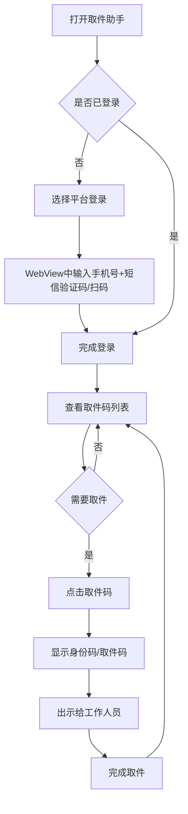

# 取件助手 App - 需求规格说明书

## 0. AI Agent 开发约定

**开发方式**：本项目采用 AI Agent 驱动开发，使用 OpenCode 桌面端作为 Agent，模型为 MiMo v2.5 Pro。

**职责分工**：
- **Agent（OpenCode + MiMo v2.5 Pro）**：负责编码实现、单元测试编写、自测验证
- **人类**：负责需求评审、验收测试、最终确认

**协作流程**：
1. 人类评审并确认需求文档
2. Agent 按阶段0（技术验证 Spike）与 MVP 分期实现功能
3. 每个任务完成后，Agent 执行 `flutter analyze` 和 `flutter test` 自测
4. 人类执行人工验收步骤，确认功能符合预期

---

## 1. 产品名称与概述

**产品名称**：取件助手

**目标用户**：经常网购、需要频繁取快递的个人用户

**产品用途**：聚合多个购物平台和快递服务的取件码，用户无需打开多个App即可快速查看和使用取件码

**核心价值**：
- 聚合多平台取件码，一个App搞定所有取件
- 支持身份码直接打开，取件更便捷
- 自动同步取件码，无需手动输入

---

## 2. 范围与边界

### 解决的问题
用户在取快递时需要打开淘宝、拼多多、菜鸟等多个App查找取件码，操作繁琐、效率低下

### 前置条件
- 用户需要安装本App
- 用户需要登录相关购物平台账号（淘宝、拼多多等）
- 用户需要授权相关权限（仅 Android：通知栏读取、短信读取）

### 明确不覆盖的内容
- 不提供快递物流追踪功能
- 不提供寄件服务
- 不提供快递价格查询

---

## 3. 用户业务流程



> **说明**：登录操作在各平台的 WebView 页面中完成，验证码由用户手动输入，Agent 不自动获取验证码。

---

## 4. 功能模块与功能点

### 功能模块分解图

```
取件助手
├── 账号管理
│   ├── 淘宝登录
│   ├── 拼多多登录
│   └── 菜鸟登录
├── 取件码管理
│   ├── 取件码列表
│   ├── 取件码详情
│   ├── 取件码同步
│   └── 历史记录
├── 身份码功能
│   ├── 淘宝身份码
│   ├── 拼多多身份码（P2 可选优化）
│   └── 菜鸟身份码
└── 设置
    ├── 通知设置（仅 Android）
    ├── 权限管理
    └── 账号管理
```

### 功能点详细说明

#### 模块一：账号管理

| 功能名称 | 功能描述 | 输入 | 输出 |
|---------|---------|------|------|
| 淘宝登录 | 用户通过淘宝账号登录，获取淘宝取件码 | 手机号+短信验证码（WebView中手动输入） | 登录状态、淘宝取件码数据 |
| 拼多多登录 | 用户通过拼多多账号登录，获取拼多多取件码（P2） | 手机号+短信验证码（WebView中手动输入） | 登录状态、拼多多取件码数据 |
| 菜鸟登录 | 用户通过菜鸟账号登录，获取菜鸟取件码 | 共用淘宝登录态 | 登录状态、菜鸟取件码数据 |

#### 模块二：取件码管理

| 功能名称 | 功能描述 | 输入 | 输出 |
|---------|---------|------|------|
| 取件码列表 | 显示所有平台的取件码，按时间排序 | 无 | 待取件码列表、待取数量 |
| 取件码详情 | 显示单个取件码的详细信息 | 点击取件码 | 取件码、快递公司、取件地址、预计取件时间 |
| 取件码同步 | App 打开时前台自动从各平台获取最新取件码（全平台）；Android 后台短信/通知识别作为补充（P2）；iOS 不做后台同步 | 无 | 最新的取件码列表 |
| 历史记录 | 查看已取件的历史记录，包含取件时间、取件码、快递公司等信息（P2） | 选择时间范围或平台筛选 | 历史取件记录列表 |

#### 模块三：身份码功能

| 功能名称 | 功能描述 | 输入 | 输出 |
|---------|---------|------|------|
| 淘宝身份码 | 在应用内打开淘宝H5页面，显示身份码 | 点击淘宝身份码 | 淘宝身份码页面（需首次登录） |
| 拼多多身份码 | WebView加载拼多多H5取件页，用户查看为主，不做自动解析（P2可选优化） | 点击拼多多身份码 | 拼多多取件页面 |
| 菜鸟身份码 | 在应用内打开菜鸟授权页，显示身份码 | 点击菜鸟身份码 | 菜鸟身份码页面（共用淘宝登录态） |

#### 模块四：设置

| 功能名称 | 功能描述 | 输入 | 输出 |
|---------|---------|------|------|
| 通知设置 | 设置是否接收新取件码通知（仅Android） | 开关选项 | 通知设置状态 |
| 权限管理 | 管理短信、通知栏等权限（仅Android） | 权限开关 | 权限状态 |
| 账号管理 | 查看已登录账号，支持退出登录 | 操作选择 | 账号状态 |

---

## 5. 非功能要求

### 性能要求
- App启动时间不超过3秒
- 取件码同步时间不超过5秒
- 身份码页面加载时间不超过2秒

### 安全要求
- 登录态安全保存（Keychain/Keystore）
- 不记录敏感信息

### 兼容性要求
- 支持Android 8.0及以上系统
- 支持iOS 13.0及以上系统（Flutter 3.x 稳定版最低要求 iOS 13）
- 支持主流机型适配

---

## 6. 验收要求

### 功能验收

> **可自动化范围说明**：WebView 相关流程（平台登录、身份码页面加载）无法有效自动化测试，对应单测仅覆盖 mock 层逻辑（如登录态存储），以人工验收为准；纯逻辑（数据模型、仓库、去重、状态流转）以自动化测试为准。

| 功能点 | 自动化验证方式（测试用例名/命令） | 人工验收步骤 |
|--------|--------------------------------|-------------|
| 淘宝登录 | `test/auth/taobao_login_test.dart`（仅mock登录态存储逻辑） | 在WebView中输入手机号+验证码，确认登录成功 |
| 拼多多登录（P2） | `test/auth/pdd_login_test.dart`（仅mock逻辑） | 在WebView中输入手机号+验证码，确认登录成功 |
| 菜鸟登录 | `test/auth/cainiao_login_test.dart`（仅mock逻辑） | 确认共用淘宝登录态，自动登录成功 |
| 取件码列表 | `flutter test test/pickup/pickup_list_test.dart` | 确认列表显示各平台取件码，数量正确 |
| 取件码详情 | `flutter test test/pickup/pickup_detail_test.dart` | 点击取件码，确认显示详情信息 |
| 取件码同步 | `flutter test test/pickup/pickup_sync_test.dart` | 手动刷新，确认取件码更新 |
| 历史记录（P2） | `flutter test test/pickup/history_test.dart` | 确认历史记录显示已取件信息 |
| 淘宝身份码 | —（WebView页面，人工验收） | 点击淘宝身份码，确认页面加载正常 |
| 菜鸟身份码 | —（WebView页面，人工验收） | 点击菜鸟身份码，确认页面加载正常 |

### 性能验收

| 指标 | 自动化验证方式 | 人工验收步骤 |
|------|---------------|-------------|
| App启动时间 | `flutter test integration_test/performance_test.dart` | 启动App，确认3秒内进入主页 |
| 取件码同步时间 | `flutter test integration_test/performance_test.dart` | 手动刷新，确认5秒内完成 |
| 身份码页面加载 | `flutter test integration_test/performance_test.dart` | 打开身份码，确认2秒内加载完成 |

> 性能指标需在真机上以 integration test 验证，模拟器数据不作为验收依据。

### 安全验收

| 检查项 | 自动化验证方式 | 人工验收步骤 |
|--------|---------------|-------------|
| 登录态安全保存 | `flutter test test/security/session_test.dart` | 检查安全存储，确认登录态正确保存 |
| 无敏感信息泄露 | `flutter test test/security/privacy_test.dart` | 检查日志输出，确认无敏感信息 |

---

## 7. 技术实现建议

### 数据获取方案
1. **淘宝**：通过官方H5页面，使用WebView加载身份码
2. **拼多多**：WebView加载拼多多H5取件页，用户查看为主，不做自动解析（P2可选优化）
3. **菜鸟**：共用淘宝登录态，加载菜鸟授权页
4. **快递100 API**：作为补充，通过快递单号查询取件码（P2阶段实现，**可行性待调研**：快递100公开API以物流轨迹查询为主，能否返回取件码需先验证；快递单号来源：Android短信解析、iOS手动输入）

### 技术栈建议
- 跨平台框架：Flutter
- 网络请求：Dio
- 数据存储：SQLite + 加密存储
- WebView：用于加载H5页面

---

## 8. 风险与注意事项

### 法律风险
- 各平台服务条款可能限制第三方接入
- 需要用户明确授权登录
- 建议使用官方H5页面，避免违规
- **国内上架合规**：需完成工信部 App 备案并提供隐私政策；短信、通知栏读取属敏感个人信息权限，须按《个人信息保护法》明示告知并取得用户同意
- **Google Play 政策**：READ_SMS 权限受严格限制（仅默认短信应用等场景可用），若需上架 Google Play，短信识别需替换为通知栏监听或手动方案

### 技术风险
- 淘宝/菜鸟 H5 身份码页面可能不存在，或第三方 WebView 无法完成登录（滑块验证、UA 检测）——P0 核心路线的最高风险项，须先做阶段0技术验证 Spike；失败则 P0 降级为取件码手动录入方案
- 平台页面可能更新，需要适配
- 登录态可能过期，需要重新登录
- 部分平台可能有反爬虫机制

### 用户体验风险
- 首次登录需要用户手动操作（WebView中输入验证码）
- 部分平台页面加载可能较慢
- 需要用户授权相关权限（仅Android）

---

## 9. 参考资料

### 现有App参考
- 用户提供的效果图App（身份码聚合功能；截图附件待补充，作为UI人工验收基准）
- 快递100开放平台API
- 菜鸟开放平台

### 技术文档
- Android短信读取API（仅Android）
- WebView安全配置指南
- 快递100 API文档
