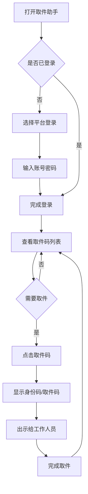

# 取件助手 App - 需求规格说明书

## 1. 产品名称与概述

**产品名称**：取件助手

**目标用户**：经常网购、需要频繁取快递的个人用户

**产品用途**：聚合多个购物平台和快递服务的取件码，用户无需打开多个App即可快速查看和使用取件码

**核心价值**：
- 聚合多平台取件码，一个App搞定所有取件
- 支持身份码直接打开，取件更便捷
- 自动同步取件码，无需手动输入

---

## 2. 范围与边界

### 解决的问题
用户在取快递时需要打开淘宝、拼多多、菜鸟等多个App查找取件码，操作繁琐、效率低下

### 前置条件
- 用户需要安装本App
- 用户需要登录相关购物平台账号（淘宝、拼多多等）
- 用户需要授权相关权限（通知栏读取、短信读取等）

### 明确不覆盖的内容
- 不提供快递物流追踪功能
- 不提供寄件服务
- 不提供快递价格查询

---

## 3. 用户业务流程



---

## 4. 功能模块与功能点

### 功能模块分解图

```
取件助手
├── 账号管理
│   ├── 淘宝登录
│   ├── 拼多多登录
│   └── 菜鸟登录
├── 取件码管理
│   ├── 取件码列表
│   ├── 取件码详情
│   └── 取件码同步
├── 身份码功能
│   ├── 淘宝身份码
│   ├── 拼多多身份码
│   └── 菜鸟身份码
└── 设置
    ├── 通知设置
    ├── 权限管理
    └── 账号管理
```

### 功能点详细说明

#### 模块一：账号管理

| 功能名称 | 功能描述 | 输入 | 输出 |
|---------|---------|------|------|
| 淘宝登录 | 用户通过淘宝账号登录，获取淘宝取件码 | 淘宝账号、密码 | 登录状态、淘宝取件码数据 |
| 拼多多登录 | 用户通过拼多多账号登录，获取拼多多取件码 | 拼多多账号、密码 | 登录状态、拼多多取件码数据 |
| 菜鸟登录 | 用户通过菜鸟账号登录，获取菜鸟取件码 | 菜鸟账号（共用淘宝登录态） | 登录状态、菜鸟取件码数据 |

#### 模块二：取件码管理

| 功能名称 | 功能描述 | 输入 | 输出 |
|---------|---------|------|------|
| 取件码列表 | 显示所有平台的取件码，按时间排序 | 无 | 待取件码列表、待取数量 |
| 取件码详情 | 显示单个取件码的详细信息 | 点击取件码 | 取件码、快递公司、取件地址、预计取件时间 |
| 取件码同步 | 自动从各平台获取最新取件码 | 无 | 最新的取件码列表 |

#### 模块三：身份码功能

| 功能名称 | 功能描述 | 输入 | 输出 |
|---------|---------|------|------|
| 淘宝身份码 | 在应用内打开淘宝H5页面，显示身份码 | 点击淘宝身份码 | 淘宝身份码页面（需首次登录） |
| 拼多多身份码 | 跳转到拼多多自提点取件页 | 点击拼多多身份码 | 拼多多取件页面 |
| 菜鸟身份码 | 在应用内打开菜鸟授权页，显示身份码 | 点击菜鸟身份码 | 菜鸟身份码页面（共用淘宝登录态） |

#### 模块四：设置

| 功能名称 | 功能描述 | 输入 | 输出 |
|---------|---------|------|------|
| 通知设置 | 设置是否接收新取件码通知 | 开关选项 | 通知设置状态 |
| 权限管理 | 管理短信、通知栏等权限 | 权限开关 | 权限状态 |
| 账号管理 | 查看已登录账号，支持退出登录 | 操作选择 | 账号状态 |

---

## 5. 非功能要求

### 性能要求
- App启动时间不超过3秒
- 取件码同步时间不超过5秒
- 身份码页面加载时间不超过2秒

### 安全要求
- 账号密码加密存储
- 登录态安全保存
- 不记录敏感信息

### 兼容性要求
- 支持Android 8.0及以上系统
- 支持iOS 12.0及以上系统
- 支持主流机型适配

---

## 6. 验收要求

### 功能验收
- [ ] 能够成功登录淘宝、拼多多、菜鸟账号
- [ ] 能够正确显示各平台取件码
- [ ] 能够正常打开各平台身份码页面
- [ ] 取件码同步功能正常
- [ ] 通知功能正常

### 性能验收
- [ ] App启动时间符合要求
- [ ] 取件码同步时间符合要求
- [ ] 身份码页面加载时间符合要求

### 安全验收
- [ ] 账号密码加密存储
- [ ] 登录态安全保存
- [ ] 无敏感信息泄露

---

## 7. 技术实现建议

### 数据获取方案
1. **淘宝**：通过官方H5页面，使用WebView加载身份码
2. **拼多多**：跳转到拼多多自提点取件页
3. **菜鸟**：共用淘宝登录态，加载菜鸟授权页
4. **快递100 API**：作为补充，通过快递单号查询取件码

### 技术栈建议
- 跨平台框架：Flutter或React Native
- 网络请求：Retrofit/Dio
- 数据存储：SQLite + 加密存储
- WebView：用于加载H5页面

---

## 8. 风险与注意事项

### 法律风险
- 各平台服务条款可能限制第三方接入
- 需要用户明确授权登录
- 建议使用官方H5页面，避免违规

### 技术风险
- 平台页面可能更新，需要适配
- 登录态可能过期，需要重新登录
- 部分平台可能有反爬虫机制

### 用户体验风险
- 首次登录需要用户手动操作
- 部分平台页面加载可能较慢
- 需要用户授权相关权限

---

## 9. 参考资料

### 现有App参考
- 用户提供的效果图App（身份码聚合功能）
- 快递100开放平台API
- 菜鸟开放平台

### 技术文档
- Android短信读取API
- iOS SMS Auto-fill API
- WebView安全配置指南
